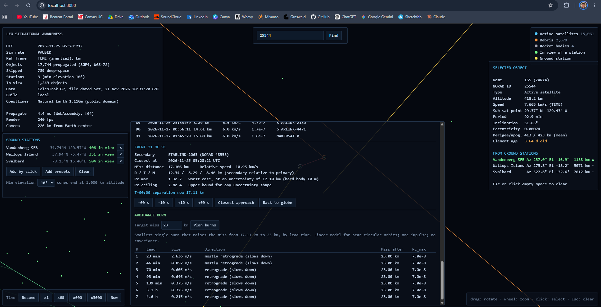
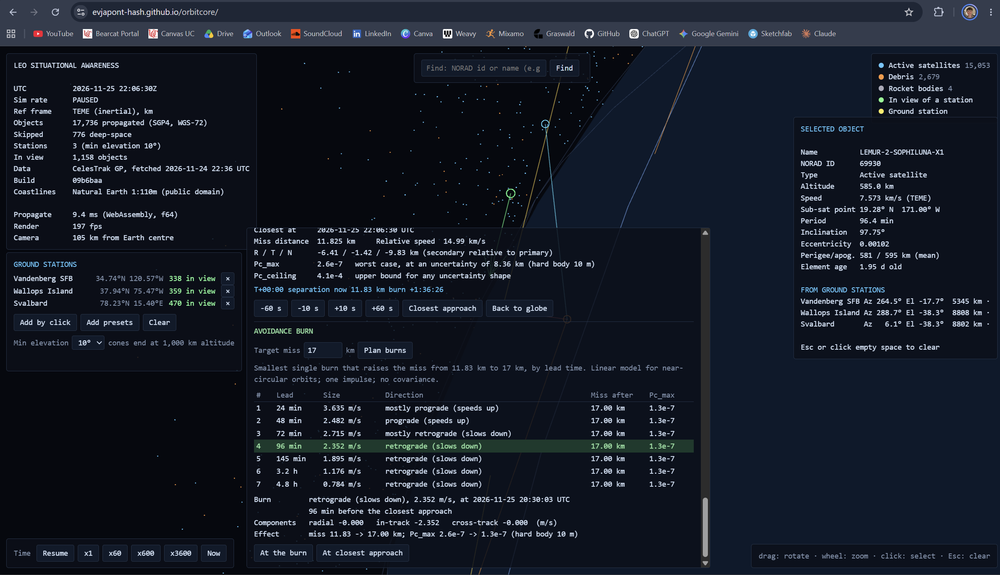

# orbitcore

[](https://github.com/evjapont-hash/orbitcore/actions/workflows/ci.yml)

**A real-time 3D picture of low Earth orbit, with conjunction screening and avoidance-burn planning, built on a C++20 orbital-mechanics core that runs both natively and in the browser.**

**Live demo: <https://evjapont-hash.github.io/orbitcore/>** (public element sets, refreshed every 6 hours)


This project uses only unclassified, publicly available data. It is an engineering and learning project, **not an operational tool**. See [Honest limits](#honest-limits).

## What it does

- **Propagates the whole public catalog** (about 17,700 near-Earth objects) with SGP4 in C++20, validated against Vallado's reference vectors, in 3.4 ms natively and about 4.4 ms in the browser (WebAssembly).
- **Draws it in 3D** (WebGL2): a WGS-84 globe with coastlines, one instanced point per object, click-to-select with orbit tracks, and ground stations with visibility cones and live azimuth / elevation / range.
- **Screens one satellite against the whole catalog** for close approaches over days, finding the same encounters a brute-force search finds with about 300x fewer propagations.
- **Bounds the collision probability** without pretending to have a covariance (public element sets carry none): a worst case over the size of the uncertainty, and a hard ceiling for any uncertainty shape.
- **Plans an avoidance burn**: the smallest single burn, for each of several lead times, that raises the miss distance to a target. It is checked against brute-force orbital dynamics and drawn on the globe.
- **Handles frames carefully**: frame- and unit-tagged vectors (TEME, ECEF, ENU, NED, RTN), so mixing frames is a compile error.





## Numbers

Measured on an Intel Core i9-14900HX (Release build, single thread). Your machine will differ.

| What | Result |
|------|--------|
| Propagate all ~17.7k objects, native | 3.4 ms median (192 ns per object) |
| Same, in the browser (WebAssembly, double precision) | about 4.4 ms; the page renders at 150 to 240 fps |
| Screen the ISS against the whole catalog, 3 days, 25 km, native | about 2.7 s (about 14 million SGP4 evaluations) |
| Same kind of search by brute force vs. this algorithm (2 h, 100 km) | 21,030 ms vs. 90.5 ms: 294x fewer evaluations, identical 160 encounters |
| Screen the ISS, 6 hours, in WebAssembly | about 0.28 s, in small chunks so the page keeps animating |
| Tests | 49 C++ tests, 6 JavaScript suites, a WebAssembly-vs-native check; CI builds with g++ and clang++ under AddressSanitizer and UBSan |

The evidence behind these is in [docs/VALIDATION.md](docs/VALIDATION.md).

## Quick start

Build and test natively:

```sh
cmake -S . -B build -DORBITCORE_SANITIZE=ON
cmake --build build -j
./build/orbitcore_tests
```

Screen the ISS from the command line (needs a catalog file; the download script is polite to CelesTrak, so do not run it more than a few times a day):

```sh
cmake -S . -B build-release -DCMAKE_BUILD_TYPE=Release
cmake --build build-release -j
bash scripts/fetch_catalog.sh ~/catalog.tle
./build-release/conjunction_cli ~/catalog.tle --primary 25544 --days 3 --threshold-km 25 --hbr-m 50
```

Run the viewer locally (needs [Emscripten](https://emscripten.org); CI uses 6.0.13):

```sh
source ~/emsdk/emsdk_env.sh
emcmake cmake -S . -B build-wasm -DCMAKE_BUILD_TYPE=Release
cmake --build build-wasm -j
bash scripts/serve_web.sh ~/catalog.tle        # then open http://localhost:8080
node wasm/test_node.cjs examples/iss_2008.tle ~/catalog.tle   # WebAssembly vs. native
node web/maneuver.test.mjs                     # and the other web/*.test.mjs files
```

## Honest limits

- **Public element sets (TLEs) are about 1 km accurate at their epoch and degrade by kilometres per day.** Encounters with miss distances of a few kilometres cannot be resolved with this data, and the viewer flags element sets that are more than 3 days old.
- **There is no covariance**, so collision probability is given as bounds, not a prediction.
- **The burn planner is a linear planning aid** for near-circular orbits and short lead times. It ignores J2 and drag in the burn response and does not re-screen the new orbit for new conjunctions.
- **Near-Earth only** (orbital period under 225 minutes): deep-space objects are skipped.
- GMST is computed from UTC (up to 0.9 s of UT1 error); polar motion and nutation are neglected.

The details are in [docs/CONJUNCTION.md](docs/CONJUNCTION.md).

## Repository layout

| Path | What is there |
|------|---------------|
| `include/orbitcore/`, `src/` | the C++20 library: time, frames, TLE parser, SGP4, catalog, ground-station visibility, conjunction screening, collision-probability bounds, avoidance-burn planner |
| `wasm/` | the `Engine` wrapper (header-only, no Emscripten dependency, so it is tested natively), the Embind bindings, and a Node check |
| `web/` | the viewer: `index.html`, `main.js`, small modules (`mat4`, `picking`, `geometry`, `screening`, `maneuver`), and their tests |
| `tools/` | `orbit_cli`, `catalog_bench`, `conjunction_cli` |
| `tests/` | C++ tests (a small custom harness) and the Vallado reference data |
| `scripts/` | `fetch_catalog.sh`, `serve_web.sh` |
| `.github/workflows/` | `ci.yml` (build and test) and `deploy.yml` (6-hourly data refresh and GitHub Pages deploy) |
| `docs/` | [ARCHITECTURE](docs/ARCHITECTURE.md), [CONJUNCTION](docs/CONJUNCTION.md), [VALIDATION](docs/VALIDATION.md) |

## Data and credits

- Element sets: public general-perturbations data from [CelesTrak](https://celestrak.org).
- SGP4 follows Vallado, Crawford, Hujsak and Kelso, *Revisiting Spacetrack Report #3* (AIAA 2006-6753); the reference vectors in `tests/data` are theirs (attribution in `tests/data/README.md`).
- Coastlines: [Natural Earth](https://www.naturalearthdata.com) (public domain).