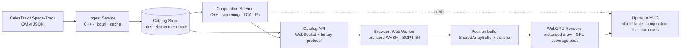

# Architecture

Single C++20 core (`orbitcore`) built twice: natively for the server and tests, and to
WebAssembly for in-browser propagation. All orbital math lives in C++; the frontend only renders.

## Frames and units

| Frame | Meaning | Used for |
|-------|---------|----------|
| TEME  | SGP4 output (true equator, mean equinox) | propagation, conjunction math |
| ECEF  | Earth-fixed, WGS-84 | ground tracks, station geometry |
| ENU / NED | local tangent at a station | look angles, coverage cones |
| RTN   | radial / in-track / normal about a reference object | conjunction geometry, burn vectors |

Lengths km, velocities km/s, angles rad internally. SGP4 uses WGS-72 constants; geodetic uses WGS-84.

## Known limitations (state these in the UI too)

- TLE/OMM accuracy is ~1 km at epoch and degrades by km/day.
- Near-Earth only (period < 225 min); deep-space (SDP4) not implemented.
- GMST computed from UTC (up to 0.9 s UT1 error); polar motion and nutation neglected in TEME->ECEF.
