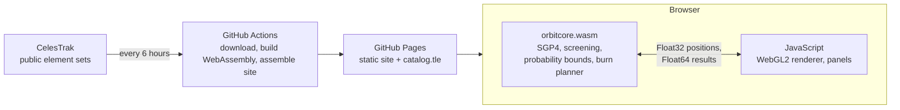

# Architecture

One C++20 library (`orbitcore`) built two ways: natively (command-line tools, tests, benchmarks) and to WebAssembly (the browser). **All orbital mathematics lives in C++**; the JavaScript only draws and handles input. The site is fully static: there is no server of mine to keep running.

## The C++ library

| Module | Responsibility |
|--------|----------------|
| `units`, `time` | constants, WGS-72 / WGS-84 parameters; two-part Julian dates (keeps sub-millisecond precision); GMST |
| `frames` | frame- and unit-tagged vectors; TEME to ECEF, geodetic, ENU, NED, look angles, RTN |
| `tle` | fixed-column element-set parser with checksum validation |
| `sgp4` | near-Earth SGP4 following Vallado et al. (AIAA 2006-6753), WGS-72 |
| `catalog` | loads a catalog, batch-propagates every object, exposes each object's elements and propagator |
| `visibility` | per-station frame, elevation test for the whole catalog at once, look angles |
| `conjunction` | screening one primary against the catalog; closest-approach refinement |
| `risk` | collision-probability bounds (see [CONJUNCTION](CONJUNCTION.md)) |
| `maneuver` | the avoidance-burn planner (linear relative motion, exact minimization) |

`wasm/engine.hpp` is a thin stateful wrapper that owns the buffers JavaScript reads. It has no Emscripten dependency, so it is unit-tested natively; `wasm/orbitcore_wasm.cpp` only declares the bindings.

## The browser

- Every frame: the engine propagates all objects in double precision and hands back one `Float32Array` of positions (float32 only at the last step, for the GPU). The renderer draws them as instanced point sprites; picking is done by projecting positions on the CPU.
- Screening runs as a **session** (`screenBegin`, then repeated `screenStep(n)`, then `screenResults`): the page does a slice of work of about 16 ms, lets a frame render, and continues, so the display never freezes. The slice size adapts to the measured speed.
- The burn planner is a second call on a finished session (`planAvoidance`); the page decodes the packed results, lists them, and draws the chosen burn.
- A Web Worker was considered. Cooperative chunking on the main thread was chosen first because it is simple and fully testable, and the session API is exactly what a Worker would call, so moving it later is a small change.

## Frames and units

| Frame | Meaning | Used for |
|-------|---------|----------|
| TEME | SGP4 output (true equator, mean equinox) | propagation, conjunction geometry, rendering |
| ECEF | Earth-fixed, WGS-84 | station geometry, geodetic coordinates |
| ENU / NED | local tangent plane at a station | look angles, visibility |
| RTN | radial / in-track / cross-track about a reference object | miss vectors, burn directions |

Lengths are km, velocities km/s, angles radians internally. SGP4 uses WGS-72 constants (the model is defined against them); geodetic conversion uses WGS-84. The tagged vector types make mixing frames or units a compile error.

## Deployment

`deploy.yml` runs every 6 hours and on every push: it downloads the catalog (and, if CelesTrak is unreachable, reuses the last published one and says so in the page's build information), installs Emscripten, builds the WebAssembly, assembles the static site, and publishes it to GitHub Pages. `ci.yml` builds and tests with g++ and clang++ under AddressSanitizer and UBSan and runs the JavaScript tests.

## Design decisions

1. **One core, two targets.** The same code is tested natively and shipped to the browser; a Node test checks WebAssembly against native.
2. **Double precision for physics, single only for drawing.** Positions are about 7,000 km; float32 would be metre-level noisy before any maths happened.
3. **Conservative advancement for screening** instead of fixed time steps, so a fast encounter cannot be stepped over (details and validation in CONJUNCTION and VALIDATION).
4. **Bounds instead of a made-up probability.** Public element sets have no covariance, so inventing one would produce a precise-looking, meaningless number.
5. **A linear burn model, validated by brute force.** The closed-form model is explainable and fast; its accuracy is checked against numerical dynamics rather than assumed.

## Known limitations

See [Honest limits in the README](../README.md#honest-limits) and the longer list in [CONJUNCTION](CONJUNCTION.md#limits).